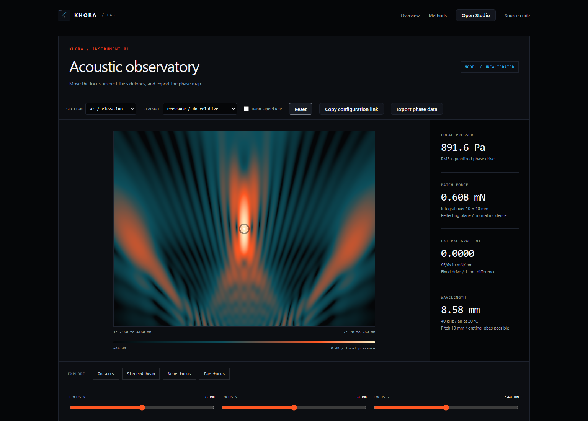

# KHORA

Open tools for aerial imaging and mid-air haptics.

**[Try the demo](https://iriss-dev.github.io/khora/)** · **[Open the lab](https://iriss-dev.github.io/khora/platform/lab.html)** · [Engineering audit](docs/ENGINEERING_AUDIT.md) · [Contribute](CONTRIBUTING.md)



Move a focus through a simulated 16 × 16 ultrasonic array. Inspect interference in three planes, compare aperture weighting, estimate radiation force over a patch, and export the 256-channel phase map. The browser calculation runs locally, with no account or external services.

The optical study illustrates a dihedral corner reflector array (DCRA): a real aerial image at the ideal plane-symmetric position. The interactive assembly is a visualization, not a recording of a built device.

## What is available

- A Spanish/English landing page and a WebGL field inspector with shareable configurations.
- Python reference models: piston directivity, complex pressure superposition, patch-force integration, and numerical Rayleigh integration for comparison.
- An ideal DCRA ray model, kinematics utilities, and a Rust numerical core.
- A versioned Web Serial protocol and C receiver for staging phase data with outputs disabled.
- Reproducible numerical tests, CAD concepts, and an engineering audit with sources and open questions.

**Status: v0.2.0-alpha.** Pressure and force use an illustrative, uncalibrated emitter amplitude. They do not establish tactile perception, exposure limits, levitation, or a working physical prototype. There is no board-specific output driver or validated end-to-end tracking loop. The serial demo has no ARM command. Rust tests target the default `std` feature; bare-metal support is not validated.

## Run locally

```sh
git clone https://github.com/iriss-dev/khora.git
cd khora
python -m http.server 8765
```

Open [the local website](http://localhost:8765/platform/) or [the local lab](http://localhost:8765/platform/lab.html). WebGL is needed for field rendering. Web Serial requires a supporting browser and an explicitly selected device implementing [KH v1](docs/HARDWARE_TRANSPORT.md).

## Validate

Python 3.10+ and Node.js 20+:

```sh
python -m unittest discover -s tests -v
node --test tests/test_platform.cjs
```

With a C99 compiler, CMake, and Rust installed:

```sh
cmake -S firmware -B build/firmware
cmake --build build/firmware
ctest --test-dir build/firmware --output-on-failure
cargo test --manifest-path crates/khora-core/Cargo.toml
```

The browser tests require Playwright and an installed browser. They default to Microsoft Edge; set `KHORA_BROWSER_CHANNEL=chrome` for Chrome. Make the `playwright` package available through your environment or `NODE_PATH`, then run:

```sh
node tests/browser_smoke.cjs
node tests/landing_smoke.cjs
```

## Work with the project

The most useful next contribution is a reproducible single-emitter calibration: amplitude, directivity, phase delay, measurement geometry, and uncertainty. Optical alignment measurements and board-driver implementations are also welcome. [Open an experiment or bug report](https://github.com/iriss-dev/khora/issues/new/choose).

| Area | Entry point |
| --- | --- |
| Acoustic reference | [python/khora/acoustic_field.py](python/khora/acoustic_field.py) |
| Browser model and shader | [platform/acoustic-field.js](platform/acoustic-field.js) |
| Transport and receiver | [docs/HARDWARE_TRANSPORT.md](docs/HARDWARE_TRANSPORT.md) |
| Assumptions and limitations | [docs/ENGINEERING_AUDIT.md](docs/ENGINEERING_AUDIT.md) |
| Hardware planning | [docs/HARDWARE_BOM.md](docs/HARDWARE_BOM.md) |
| Launch material | [docs/LAUNCH.md](docs/LAUNCH.md) |

Code and original launch assets are [MIT licensed](LICENSE). Bundled Three.js retains its upstream license notices.
