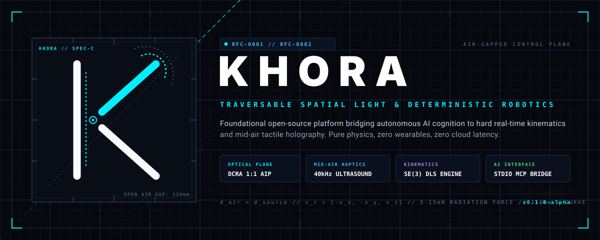

<div align="center">



# KHORA (χώρα)
### Deterministic Robotics Kinematics, Spatial Computing & Traversable Light

[](LICENSE)
[](specs/RFC-0001-SPATIAL-LIGHT-AND-HAPTICS.md)
[](specs/RFC-0002-DETERMINISTIC-ROBOTICS-AND-MCP-PLANE.md)
[](specs/)

**KHORA** is an open-source engineering platform designed to bridge non-deterministic cognitive AI with hard real-time physical robotics and traversable, mid-air holographic computing.

</div>

---

## 1. Overview & Philosophical Substrate

In classical philosophy, **Khôra** (*χώρα*) designates the formless, receptive spatial matrix wherein abstract concepts materialize into tangible physical form. 

Modern robotics and spatial computing suffer from two severe structural divides:
1. **The Cognitive vs. Real-Time Divide**: AI foundation models and LLMs operate asynchronously and probabilistically. Direct connection of neural models to physical actuators causes catastrophic safety failures due to latency variance and hallucinated coordinate setpoints.
2. **The Spatial Computing Isolation Divide**: Virtual and augmented reality currently rely on head-mounted displays (HMDs) that isolate the human operator from their physical tools, or project onto smoke/vapor screens that destroy tactile immersion.

`KHORA` provides the mathematical foundation and physical architecture to solve both problems:
- **Traversable Spatial Light**: 1:1 real aerial image formation via Dihedral Corner Reflector Arrays (DCRA) combined with 40 kHz ultrasonic acoustic radiation pressure, allowing human operators to physically pass their hands through light while feeling distinct tactile sensations in open air.
- **Three-Plane Deterministic Control**: Strict architectural separation between Cognitive Intent (LLMs / MCP), Kinematic Supervision (Jerk-limited S-Curves & Damped Least Squares IK), and Real-Time Hardware Pulsing (CAN / RTOS / Bare-Metal).

---

## 2. System Architecture

```
                          [ COGNITIVE LAYER ]
                     AI Agent / Operator Intent
                       (Claude / GPT / Gemini)
                                 │
                   Standard Stdio MCP Protocol
                                 │
                                 ▼
                 ┌───────────────────────────────┐
                 │  KINEMATIC SUPERVISORY ENGINE │
                 │  - SE(3) Homogeneous Transforms│
                 │  - S-Curve (7-Phase) Jerk Bnd │
                 │  - DLS Singularity Rejection  │
                 └───────────────┬───────────────┘
                                 │
                 250 Hz Ring Buffer / Watchdog
                                 │
        ┌────────────────────────┴────────────────────────┐
        ▼                                                 ▼
[ PHYSICAL ACTUATION PLANE ]                     [ SPATIAL LIGHT & HAPTICS ]
- Microsecond Step/Dir Gen                       - Aerial Imaging Plate (DCRA)
- Closed-Loop FOC Current                        - 40 kHz Phased Array Beamforming
- CAN Bus Hardware E-Stop                        - 5-15 mN Free-Air Radiation Pressure
```

---

## 3. Repository Structure

```
khora/
├── assets/
│   └── logo/              # Human-crafted 2D vector brand identity (SVG)
├── specs/
│   ├── RFC-0001.md        # Traversable Optical Field & Ultrasonic Haptics
│   └── RFC-0002.md        # Three-Plane Determinism & MCP Architecture
├── python/
│   └── khora/             # Core spatial physics, kinematics & MCP server
│       ├── __init__.py
│       ├── kinematics.py  # SE(3) transforms, DLS IK solver, S-curves
│       ├── optics.py      # DCRA dihedral ray propagation simulation
│       ├── haptics.py     # 40kHz acoustic radiation phased-array beamformer
│       └── mcp_server.py  # Model Context Protocol stdio interface
├── crates/                # High-performance no_std Rust modules (in progress)
├── firmware/              # STM32 / RP2040 hard real-time C firmware
└── tests/                 # Comprehensive unit test suites
```

---

## 4. Mathematics & Physical Principles

### 4.1 Optical Retro-Reflection (DCRA)
An Aerial Imaging Plate contains an orthogonal grid of microscopic dihedral mirrors. An incident light ray $\vec{v}_i = [v_x, v_y, v_z]^T$ reflects across both perpendicular mirror walls:

$$\vec{v}_r = [-v_x, -v_y, v_z]^T$$

This retro-reflects light in the horizontal plane while leaving vertical propagation unaltered. All light diverging from an object at $(x, y, -z)$ converges into open air at $(x, y, +z)$, creating an unobstructed real image that the human hand can traverse without goggles or gloves.

### 4.2 Mid-Air Acoustic Radiation Pressure
A 40 kHz transducer array synthesizes a high-intensity ultrasound focus at coordinate $\vec{r}_f$. The required phase offset for the $m$-th transducer at $\vec{r}_m$ is:

$$\phi_m = -k \|\vec{r}_f - \vec{r}_m\| \pmod{2\pi}, \quad k = \frac{2\pi f}{c}$$

The resulting non-linear acoustic radiation pressure produces a localized force on the skin:

$$P_{rad} = \frac{2 \langle I \rangle}{c} = \frac{p_{rms}^2}{\rho_0 c^2} \approx 5 \sim 15\,\text{mN}$$

Modulating the carrier at 200 Hz activates cutaneous mechanoreceptors, generating a crisp mechanical tactile sensation in empty air.

---

## 5. Quickstart

### Prerequisites
- Python 3.10+ (Standard library only; zero mandatory third-party dependencies for core simulation)

### Running the Test Suite
```bash
python -m unittest discover -s tests -v
```

### Starting the MCP Server
```bash
python -m khora.mcp_server
```

---

## 6. Phased Roadmap

- [x] **Phase 01: Geometric Identity & System Specifications** (RFC-0001, RFC-0002, 2D Vector CAD Assets)
- [x] **Phase 02: Core Physics Engine & MCP Bridge** (Kinematics SE(3), DCRA Optics, 40kHz Ultrasound Beamformer)
- [ ] **Phase 03: High-Performance Rust Kinematics Engine** (`crates/khora-core` with SIMD matrix acceleration)
- [ ] **Phase 04: Hardware Phased-Array Transducer Driver** (RP2040 64-channel PWM phase-shifting firmware)
- [ ] **Phase 05: Open-Source DCRA Enclosure & Optical Mounts** (3D printable CAD fixtures for laboratory assembly)

---

## 7. License & Credits

Architected and developed by [iriss-dev](https://github.com/iriss-dev).  
Licensed under the [MIT License](LICENSE).
