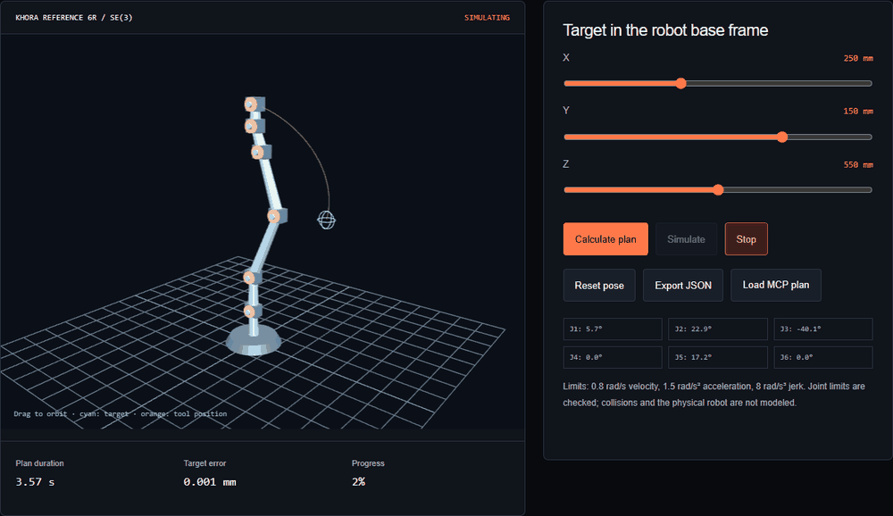

# KHORA

Browser simulations, AI tools and RP2040 firmware for spatial-computing experiments.

**[Try the website](https://iriss-dev.github.io/khora/)** · **[Robot + AI demo](https://iriss-dev.github.io/khora/platform/robot.html)** · **[Acoustic lab](https://iriss-dev.github.io/khora/platform/lab.html)** · **[Pico controller](https://iriss-dev.github.io/khora/platform/hardware.html)** · **[Community forum](https://github.com/iriss-dev/khora/discussions)**

[](https://github.com/iriss-dev/khora/actions/workflows/validate.yml)



Choose a target for a six-joint robot, inspect its trajectory in 3D, and export or replay a plan from an MCP client. In the acoustic lab, move a simulated ultrasound focus, compare aperture weighting and inspect interference in three planes. Both demos work without signing in.

## What v0.3 adds

| Component | Available now | Validation limit |
| --- | --- | --- |
| Robotics | Positional DLS, PoE forward kinematics, synchronized quintic plans, 3D playback | Reference geometry; no collision or dynamic model |
| AI connection | Installable MCP stdio server, tool schemas, lifecycle, numerical validation | AI can plan and stage; no ARM or motor execution tool |
| Raspberry Pi Pico | 16 parallel 40 kHz channels via one PIO machine and chained DMA, three waveform banks | Compiled with Pico SDK; electrical output not bench-measured |
| Feetech STS3215 | Calibrated position packets, guarded UART forwarding, telemetry and 50 ms host lease | Requires measured mechanical limits and physical gates |
| Output interlock | MCU heartbeat expiry, latched faults, physical loop/button, separate acoustic/servo gates | Gate propagation and physical stopping time need measurement |
| Tracking | Official Ultraleap binding adapter and browser MediaPipe target selection | Webcam coordinates are virtual; real sensor registration is required |
| Community | Public GitHub Discussions with a visible entry on the website | Original BBS posts remain labelled local examples |

The physical profile is **16 emitters in a 4 × 4 array at 16 mm pitch**. The original acoustic study models **256 emitters** and has a separate v1 transport. The Pico uses **KH v2**. Pressure/force readouts remain uncalibrated. No physical prototype, tactile threshold, exposure compliance or hard-real-time host performance is established by the demos or CI.

## Try it locally

```sh
git clone https://github.com/iriss-dev/khora.git
cd khora
python -m http.server 8765
```

Open [the website](http://localhost:8765/platform/), [robotics](http://localhost:8765/platform/robot.html) or [the Pico panel](http://localhost:8765/platform/hardware.html). WebGL renders the scenes; numerical functions and exports remain available without it. Camera tracking is optional and downloads its model only when activated.

## Connect an AI client

Python 3.10+:

```sh
pip install -e .
khora-mcp --simulate-device
```

Configure your MCP client to launch that command as a stdio server. The [configuration example](examples/mcp-client.json) also supports launching directly from a checkout. Ask it to call `khora_robot_plan_move` with `{"target_m":[0.25,0.15,0.55]}`, save the returned JSON, and load it in the robot demo. See [AI and robotics](docs/AI_AND_ROBOTICS.md) for all nine tools and the control boundaries.

## Connect hardware

```sh
pip install -e '.[hardware]'
khora-hardware                         # protocol simulator, no board required
khora-hardware --port COM4             # explicitly selected Pico, stage only
```

The default UF2 has outputs disabled. The [Pico guide](docs/PICO_HARDWARE.md) covers build commands, GPIO mapping, external supply gates, the physical stop loop, ARM conditions and the 50 ms MCU lease. TC4427 needs an external power-disable circuit; firmware alone cannot disconnect its supply. STS3215 and Dynamixel protocols are not interchangeable.

For an Ultraleap sensor, see [tracking setup and registration](docs/TRACKING.md). Real actuator use also needs the arm's actual link geometry, servo zero/direction/limits and independently verified stop circuitry.

## Validate

```sh
python -m unittest discover -s tests -v
node --test tests/test_platform.cjs tests/test_robot.cjs
cmake -S firmware -B build/firmware
cmake --build build/firmware
ctest --test-dir build/firmware --output-on-failure
cargo test --manifest-path crates/khora-core/Cargo.toml
```

Set `KHORA_PICO_HOST` to the built `khora_pico_host` executable to run the Python-to-C++ wire-protocol interoperability test. CI builds it before the Python suite. The Pico firmware has a separate cross-compilation job.

Browser checks use Playwright with Edge by default, or `KHORA_BROWSER_CHANNEL=chromium` after installing Playwright Chromium:

```sh
node tests/browser_smoke.cjs
node tests/landing_smoke.cjs
node tests/workspace_smoke.cjs
```

The workspace suite exercises plan import/export and replay, stopping, invalid requests, the 16-channel simulator, forum/archive links, mobile layout, and camera target wiring with a mocked detector/video stream. This is not evidence of real sensor accuracy or hardware operation.

## Join the project

**[Open the community forum](https://github.com/iriss-dev/khora/discussions)** to ask a question or share a setup. You can read without an account. The [website's forum page](https://iriss-dev.github.io/khora/platform/community.html) explains the categories and links to the original BBS examples.

Useful contributions include single-emitter calibration, logic-analyzer captures of phase and gate timing, mechanical calibration datasets, and collision checks for the reference arm. See [the contribution guide](CONTRIBUTING.md) and [open issues](https://github.com/iriss-dev/khora/issues).

Methods: [engineering audit](docs/ENGINEERING_AUDIT.md), [Pico hardware](docs/PICO_HARDWARE.md), [AI/robotics](docs/AI_AND_ROBOTICS.md), [tracking](docs/TRACKING.md). Original code/assets are [MIT licensed](LICENSE); bundled libraries retain their upstream notices.
